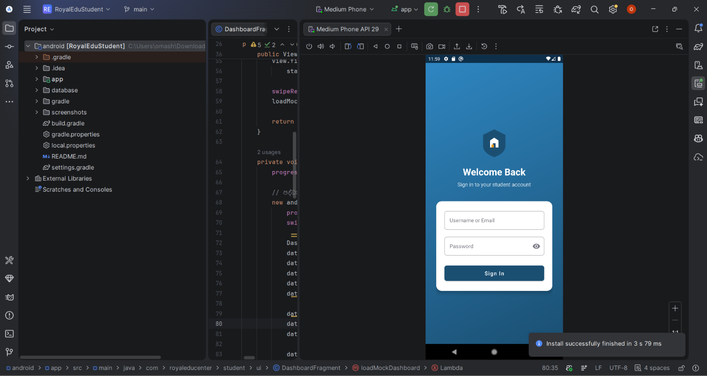
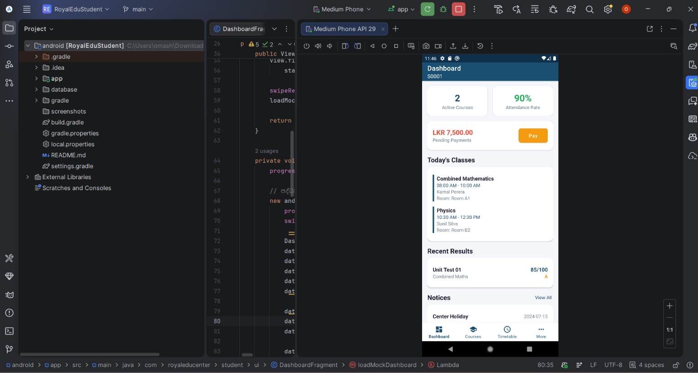
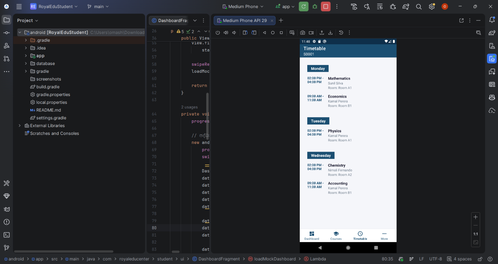
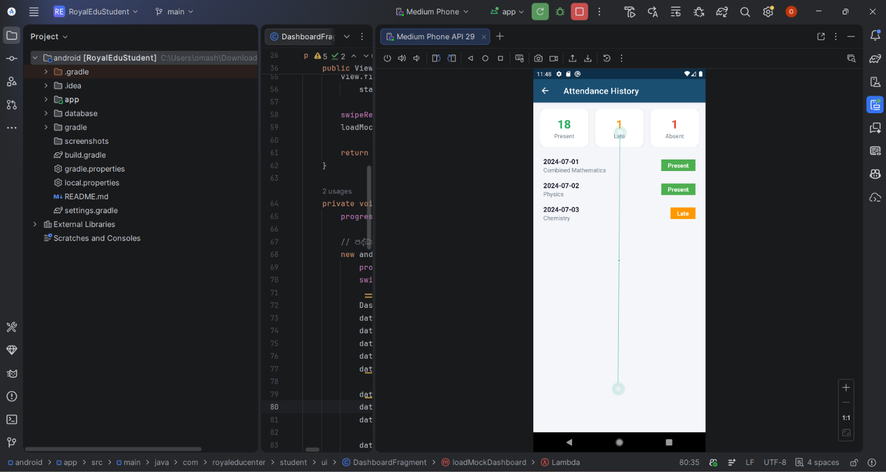
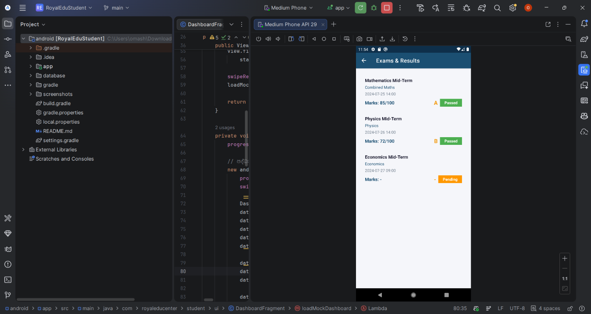
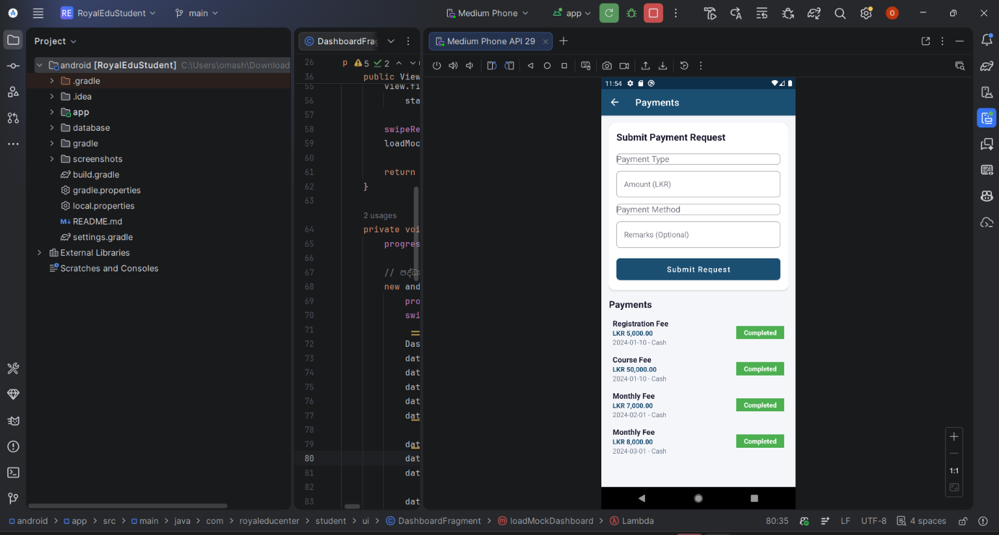
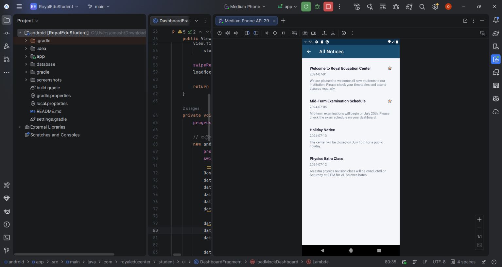
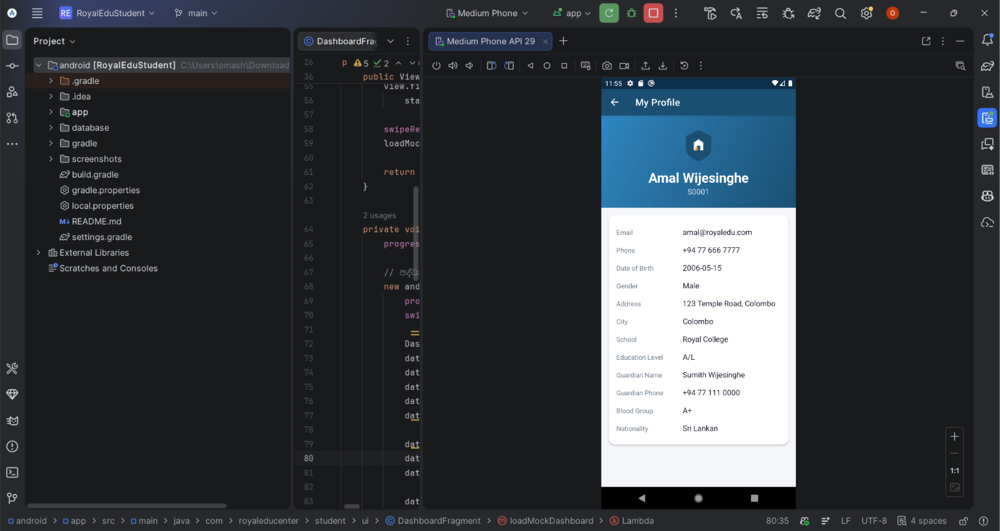

# Royal Edu Center - Student Android App

A clean, user-friendly Android app for students of Royal Education Center.

## Features
- **Login**: Token-based authentication (30-day expiry)
- **Dashboard**: Stats, today's classes, recent results, notices
- **Courses**: Browse available courses + self-enroll, view enrolled courses
- **Timetable**: Weekly timetable grouped by day
- **Attendance**: Attendance history with present/late/absent stats
- **Exams & Results**: Exam list with marks, grades, and status
- **Payments**: Payment history + submit new payment requests
- **Notices**: All notices with pinned indicators
- **Profile**: Full student profile view

## Tech Stack
- Java 17
- AndroidX + Material Components
- Retrofit2 + Gson for REST API
- OkHttp with token auth interceptor
- SwipeRefreshLayout for pull-to-refresh
- BottomNavigationView for navigation

## Setup

### Prerequisites
- Android Studio Hedgehog (2023.1) or newer
- Android SDK 34 (compileSdk 34, minSdk 24)
- Gradle 8.1+

### Configuration
1. Open `android/` folder in Android Studio
2. Update `Constants.java` → `BASE_URL` to point to your server:
   - Emulator: `http://10.0.2.2/royal-edu-center/api/`
   - Real device: `http://<your-server-ip>/royal-edu-center/api/`
3. Ensure the PHP API is accessible at that URL
4. Run the app

### API Setup
The PHP REST API is at `api/index.php`. Ensure:
- Apache/Nginx serves the `api/` directory
- `api_tokens` table exists (run updated `schema.sql`)
- `mod_rewrite` is enabled for clean URLs (or use `api/index.php/endpoint`)

## Architecture
```
android/
├── app/
│   ├── build.gradle
│   ├── proguard-rules.pro
│   └── src/main/
│       ├── AndroidManifest.xml
│       ├── java/com/royaleducenter/student/
│       │   ├── api/          # Retrofit client, service interface, auth interceptor
│       │   ├── models/        # Data models (POJOs with Gson annotations)
│       │   ├── utils/         # Constants, SessionManager
│       │   └── ui/            # Activities & Fragments
│       └── res/
│           ├── drawable/      # Vector icons, shapes
│           ├── layout/        # XML layouts
│           ├── menu/          # Bottom navigation menu
│           ├── mipmap*/       # Launcher icons
│           └── values*/       # Colors, strings, themes, dimens
├── build.gradle
├── settings.gradle
└── gradle.properties
```

## 📱 App Screenshots

| Screen | Preview |
|---|---|
| Login |  |
| Dashboard |  |
| Available Courses |  |
| My Courses |  |
| Timetable |  |
| Attendance |  |
| Results |  |
| Payments |  |
| Notices |  |
| Profile |  |

## Security
- Token-based auth (no session cookies)
- Auto-logout on 401 responses
- Tokens stored in SharedPreferences (encrypted in production)
- Cleartext traffic enabled for local dev (disable in production)
